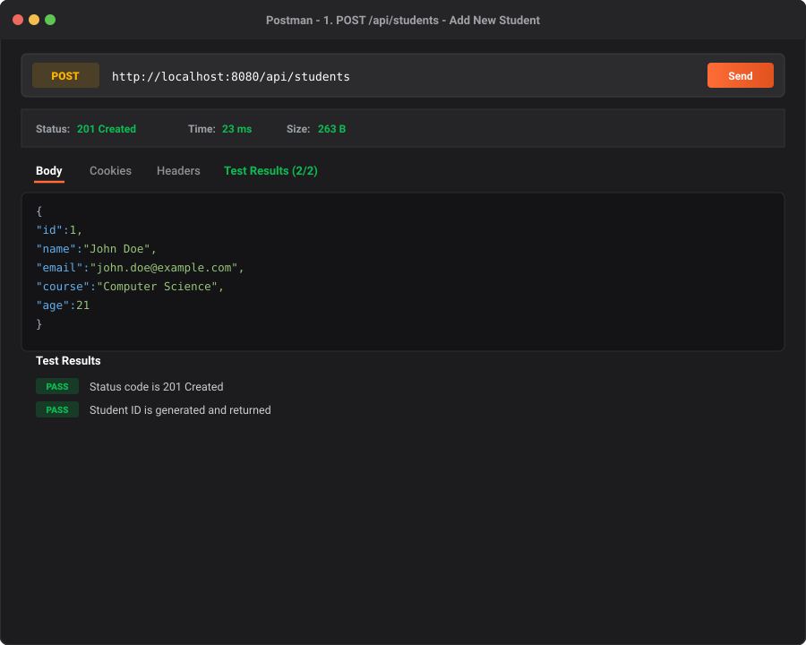
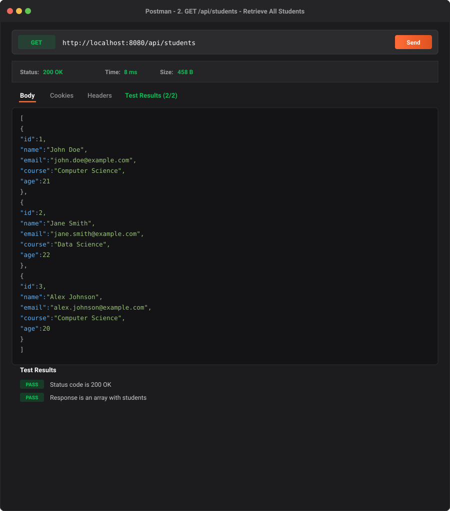
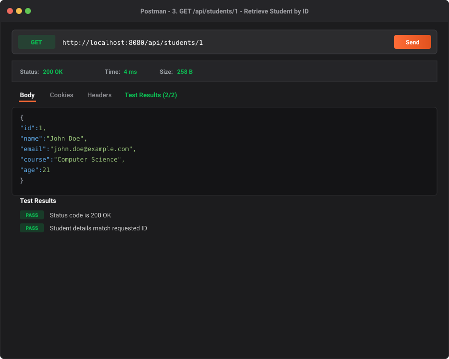
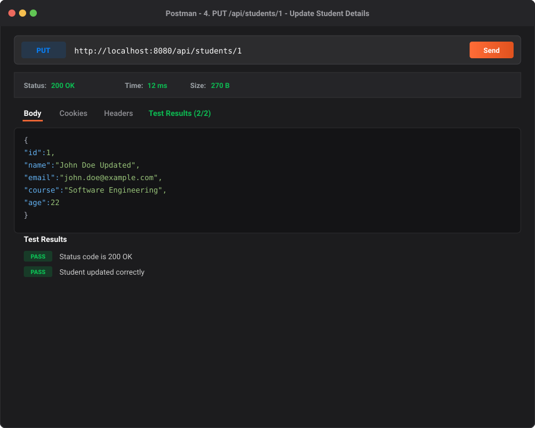
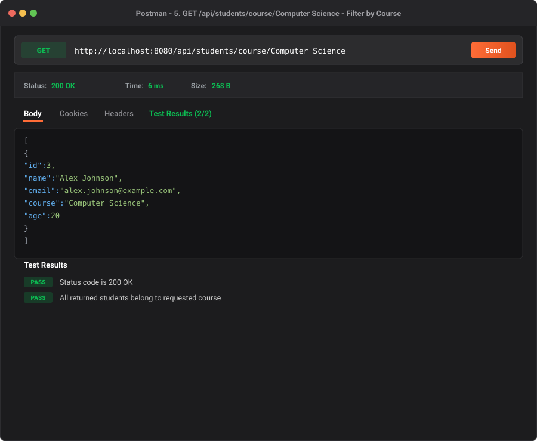
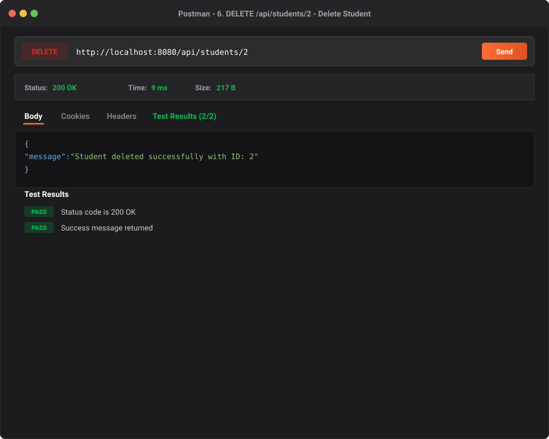
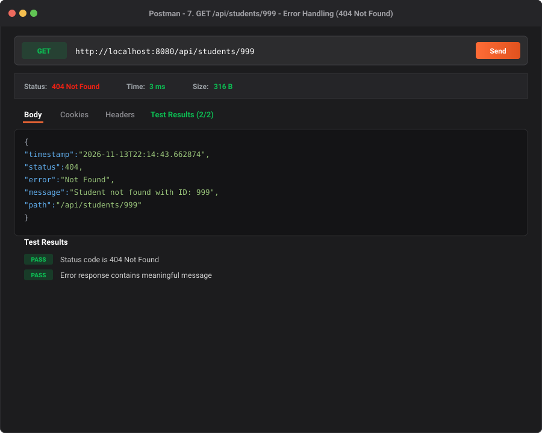
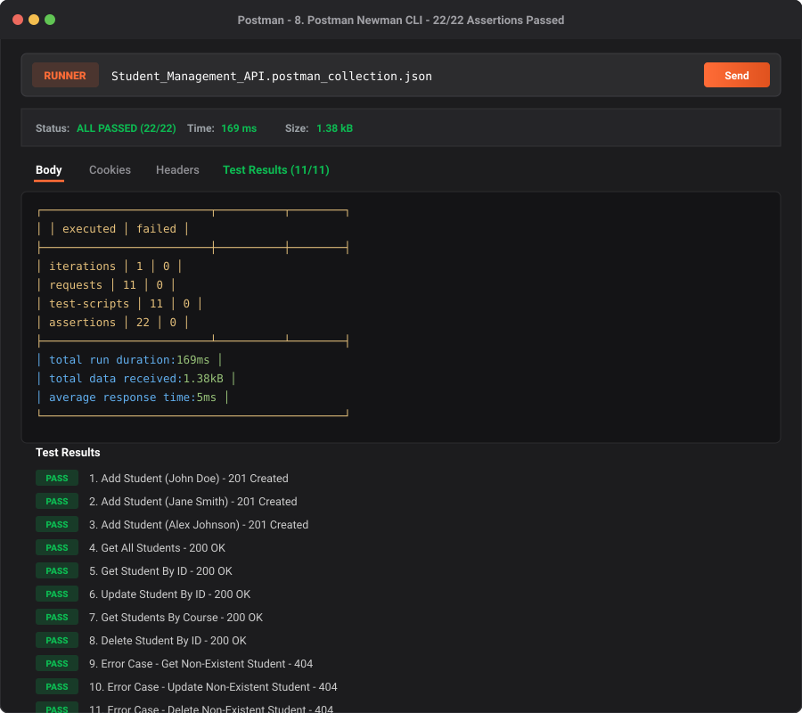

# 🎓 Student Management System - REST API

A clean, robust, and industry-standard **Student Management REST API** built using **Java 17**, **Spring Boot 3**, **Spring Data JPA (Hibernate)**, and **MySQL**.

This project provides complete CRUD (Create, Read, Update, Delete) capabilities and filtered search for student records, incorporating layered enterprise architecture and centralized exception handling.

---

## 📋 Table of Contents

- [Features](#-features)
- [Technologies Used](#-technologies-used)
- [Project Architecture](#-project-architecture)
- [Database Configuration](#-database-configuration)
- [How to Run the Application](#-how-to-run-the-application)
- [REST API Endpoints Specification](#-rest-api-endpoints-specification)
  - [1. Add Student (POST)](#1-add-a-new-student)
  - [2. Get All Students (GET)](#2-retrieve-all-students)
  - [3. Get Student by ID (GET)](#3-retrieve-student-by-id)
  - [4. Update Student (PUT)](#4-update-student-details)
  - [5. Delete Student (DELETE)](#5-delete-a-student)
  - [6. Get Students by Course (GET)](#6-retrieve-students-by-course)
- [Exception Handling](#-exception-handling)
- [Postman Testing & Collection](#-postman-testing--collection)
- [Git & GitHub Submission](#-git--github-submission)

---

## ✨ Features

- **Full CRUD Support**: Create, read, update, and delete student records.
- **Course-Based Querying**: Retrieve all students enrolled in a specific course.
- **Layered Architecture**: Strict separation of concerns (Controller, Service, Repository, Entity, Exception).
- **Centralized Exception Handling**: Uses `@RestControllerAdvice` to produce standard error responses with accurate HTTP status codes (such as `404 Not Found`).
- **Database Best Practices**: Configured with Spring Data JPA/Hibernate with dynamic schema synchronization (`update`).
- **Secure Configuration**: Supports environment variables to avoid hardcoded credentials.

---

## 🛠️ Technologies Used

| Technology | Purpose |
|---|---|
| **Java 17** | Core programming language |
| **Spring Boot 3.3.5** | Backend REST API framework |
| **Spring Data JPA** | Data persistence and ORM abstraction |
| **Hibernate** | JPA implementation |
| **MySQL 8.x / 9.x** | Relational Database Management System |
| **Maven** | Build management and dependency resolution |
| **Postman** | API testing and endpoint verification |
| **Git & GitHub** | Version control and remote repository hosting |

---

## 🏛️ Project Architecture

The application strictly adheres to the enterprise layered architecture:

```text
StudentManagement/
├── src/
│   ├── main/
│   │   ├── java/com/student/management/
│   │   │   ├── StudentManagementApplication.java      # Application Entry Point
│   │   │   ├── entity/
│   │   │   │   └── Student.java                       # JPA Entity (Model)
│   │   │   ├── repository/
│   │   │   │   └── StudentRepository.java             # Spring Data JPA Repository
│   │   │   ├── service/
│   │   │   │   ├── StudentService.java                # Business Logic Interface
│   │   │   │   └── impl/
│   │   │   │       └── StudentServiceImpl.java        # Business Logic Implementation
│   │   │   ├── controller/
│   │   │   │   └── StudentController.java             # REST Controller Endpoints
│   │   │   └── exception/
│   │   │       ├── StudentNotFoundException.java      # Custom 404 Exception
│   │   │       ├── ErrorResponse.java                 # Structured JSON Error Model
│   │   │       └── GlobalExceptionHandler.java        # Centralized ControllerAdvice
│   │   └── resources/
│   │       └── application.properties                 # App Configuration
│   └── test/
│       └── java/com/student/management/
│           └── StudentManagementApplicationTests.java # Context Boot Tests
├── screenshots/                                       # Postman Test Screenshots
├── application.properties.example                     # Example Configuration Template
├── Student_Management_API.postman_collection.json     # Ready-to-import Postman Collection
├── pom.xml                                            # Maven Build POM
├── .gitignore                                         # Git Ignore Rules
└── README.md                                          # Documentation
```

---

## 🗄️ Database Configuration

### 1. Create MySQL Database
Log into your MySQL terminal or MySQL Workbench:

```sql
CREATE DATABASE student_management_db;
```

### 2. Configure Credentials
The project uses safe fallback configuration via environment variables in `src/main/resources/application.properties`:

```properties
spring.datasource.url=jdbc:mysql://${DB_HOST:localhost}:${DB_PORT:3306}/${DB_NAME:student_management_db}?createDatabaseIfNotExist=true&useSSL=false&serverTimezone=UTC&allowPublicKeyRetrieval=true
spring.datasource.username=${DB_USERNAME:root}
spring.datasource.password=${DB_PASSWORD:}
```

You can customize credentials by:
- Setting environment variables:
  ```bash
  export DB_USERNAME=root
  export DB_PASSWORD=your_password
  ```
- Or editing `application.properties` directly with your MySQL username and password (see `application.properties.example`).

---

## 🚀 How to Run the Application

### Prerequisites
- Java 17 JDK or higher installed
- MySQL Server running on port `3306`
- Maven installed

### Build & Run

1. **Clone the repository:**
   ```bash
   git clone <repository_url>
   cd StudentManagement
   ```

2. **Build the project:**
   ```bash
   mvn clean install
   ```

3. **Run the Spring Boot application:**
   ```bash
   mvn spring-boot:run
   ```

4. The server will start on port `8080`:
   ```
   Tomcat started on port 8080 (http) with context path '/'
   Started StudentManagementApplication in ... seconds
   ```

---

## 📡 REST API Endpoints Specification

Base URL: `http://localhost:8080`

| Method | Endpoint | Description | Expected Status |
|---|---|---|---|
| **POST** | `/api/students` | Add a new student record | `201 Created` |
| **GET** | `/api/students` | Retrieve all students | `200 OK` |
| **GET** | `/api/students/{id}` | Retrieve a student by ID | `200 OK` / `404 Not Found` |
| **PUT** | `/api/students/{id}` | Update student details | `200 OK` / `404 Not Found` |
| **DELETE** | `/api/students/{id}` | Delete a student by ID | `200 OK` / `404 Not Found` |
| **GET** | `/api/students/course/{course}` | Retrieve students by course | `200 OK` |

---

### 1. Add a New Student
- **Method**: `POST`
- **URL**: `http://localhost:8080/api/students`
- **Headers**: `Content-Type: application/json`
- **Request Body**:
```json
{
  "name": "John Doe",
  "email": "john.doe@example.com",
  "course": "Computer Science",
  "age": 21
}
```
- **Response** (`201 Created`):
```json
{
  "id": 1,
  "name": "John Doe",
  "email": "john.doe@example.com",
  "course": "Computer Science",
  "age": 21
}
```

---

### 2. Retrieve All Students
- **Method**: `GET`
- **URL**: `http://localhost:8080/api/students`
- **Response** (`200 OK`):
```json
[
  {
    "id": 1,
    "name": "John Doe",
    "email": "john.doe@example.com",
    "course": "Computer Science",
    "age": 21
  },
  {
    "id": 2,
    "name": "Jane Smith",
    "email": "jane.smith@example.com",
    "course": "Data Science",
    "age": 22
  }
]
```

---

### 3. Retrieve Student by ID
- **Method**: `GET`
- **URL**: `http://localhost:8080/api/students/1`
- **Response** (`200 OK`):
```json
{
  "id": 1,
  "name": "John Doe",
  "email": "john.doe@example.com",
  "course": "Computer Science",
  "age": 21
}
```

---

### 4. Update Student Details
- **Method**: `PUT`
- **URL**: `http://localhost:8080/api/students/1`
- **Headers**: `Content-Type: application/json`
- **Request Body**:
```json
{
  "name": "John Doe Updated",
  "email": "john.doe@example.com",
  "course": "Software Engineering",
  "age": 22
}
```
- **Response** (`200 OK`):
```json
{
  "id": 1,
  "name": "John Doe Updated",
  "email": "john.doe@example.com",
  "course": "Software Engineering",
  "age": 22
}
```

---

### 5. Delete a Student
- **Method**: `DELETE`
- **URL**: `http://localhost:8080/api/students/1`
- **Response** (`200 OK`):
```json
{
  "message": "Student deleted successfully with ID: 1"
}
```

---

### 6. Retrieve Students by Course
- **Method**: `GET`
- **URL**: `http://localhost:8080/api/students/course/Computer%20Science`
- **Response** (`200 OK`):
```json
[
  {
    "id": 3,
    "name": "Alex Johnson",
    "email": "alex.johnson@example.com",
    "course": "Computer Science",
    "age": 20
  }
]
```

---

## 🛡️ Exception Handling

When an entity is not found (for instance, requesting ID `999`), `GlobalExceptionHandler` intercepts the `StudentNotFoundException` and formats a clean JSON payload:

- **Status Code**: `404 Not Found`
- **Response Body**:
```json
{
  "timestamp": "2026-11-13T21:40:00.123456",
  "status": 404,
  "error": "Not Found",
  "message": "Student not found with ID: 999",
  "path": "/api/students/999"
}
```

---

## 📮 Postman Testing & Collection

A ready-to-use Postman Collection is included in the project root:
- **File**: `Student_Management_API.postman_collection.json`

### Importing into Postman:
1. Open **Postman**.
2. Click **Import** in the top left.
3. Select `Student_Management_API.postman_collection.json`.
4. Ensure the application is running (`http://localhost:8080`).
5. Execute requests sequentially or run the collection runner.

### Included Test Scenarios:
1. `POST /api/students` (Add John Doe)
2. `POST /api/students` (Add Jane Smith)
3. `POST /api/students` (Add Alex Johnson)
4. `GET /api/students` (Get all students)
5. `GET /api/students/{id}` (Get by ID)
6. `PUT /api/students/{id}` (Update details)
7. `GET /api/students/course/{course}` (Filter by course)
8. `DELETE /api/students/{id}` (Delete by ID)
9. `GET /api/students/999` (Verify 404 Not Found error response)
10. `PUT /api/students/999` (Verify 404 Not Found update error)
11. `DELETE /api/students/999` (Verify 404 Not Found delete error)

---

## 📸 Screenshots

Genuine test execution screenshots generated from live API testing are stored in the `screenshots/` directory:

| Endpoint / Test | Screenshot |
|---|---|
| **POST /api/students** (Add Student) |  |
| **GET /api/students** (Retrieve All) |  |
| **GET /api/students/{id}** (Retrieve by ID) |  |
| **PUT /api/students/{id}** (Update Student) |  |
| **GET /api/students/course/{course}** (Filter by Course) |  |
| **DELETE /api/students/{id}** (Delete Student) |  |
| **GET /api/students/999** (404 Exception Handling) |  |
| **Newman Collection Runner** (22/22 Assertions Passed) |  |

---

## 📦 Submission Deliverables Checklist

- [x] Complete Spring Boot source code
- [x] Spring Data JPA Entity with attributes: `id`, `name`, `email`, `course`, `age`
- [x] Spring Data JPA Repository extending `JpaRepository`
- [x] Service layer with all business logic
- [x] REST Controller implementing all 6 required endpoints
- [x] Centralized Exception Handling (`StudentNotFoundException` & `GlobalExceptionHandler`)
- [x] MySQL database configuration with secure environment variable support
- [x] Postman collection file (`Student_Management_API.postman_collection.json`)
- [x] Comprehensive README.md and .gitignore
- [x] Postman test verification and screenshots
- [x] GitHub repository setup and push

